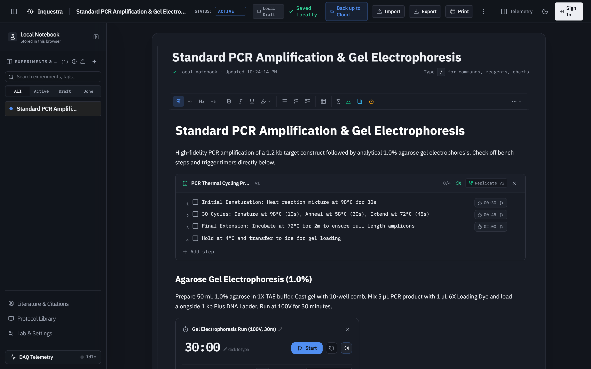

# Inquestra

**Website:** [inquestra.org](https://inquestra.org) · **Source:** [github.com/kaleb973/Inquestra](https://github.com/kaleb973/Inquestra) · **License:** [MIT](LICENSE)

Open-source, local-first Electronic Lab Notebook (ELN) and bench data acquisition workspace for life sciences, chemistry, biotech, materials science, and engineering.



## Features

- **Local-first workspace:** Persists drafts in browser `localStorage` with quota-safe backup alerts and portable ZIP/JSON/Markdown exports without requiring an account ([inquestra.org/app](https://inquestra.org/app)).
- **Web Serial hardware DAQ:** Streams live serial telemetry directly from benchtop instruments, balances, probes, and microcontrollers via `navigator.serial` ([Hardware Specs](https://inquestra.org/hardware) · [Live Simulator](https://inquestra.org/demo)).
- **Scientific editor blocks:** TipTap block canvas with protocol checklists, step timers, KaTeX equations, PubChem 2D chemical structure resolution, DNA/RNA/protein sequence ($T_m$, GC%) calculators, and PubMed / Europe PMC citations.
- **Provenance & inventory:** Optional self-hosted PostgreSQL persistence via Prisma ORM with SHA-256 record sealing, append-only audit logs, reagent lot tracking, and 2D/QR label scanning ([Provenance](https://inquestra.org/provenance) · [Architecture](https://inquestra.org/architecture)).

## Stack

- Next.js 15 (App Router), React 19, TypeScript (strict mode)
- Tailwind CSS, Zustand, TipTap
- PostgreSQL + Prisma ORM, Supabase Auth (optional cloud persistence)

## Local Development

```bash
git clone https://github.com/kaleb973/Inquestra.git
cd Inquestra
npm install
npm run dev
```

- Marketing Site: [http://localhost:3000](http://localhost:3000)
- Workspace: [http://localhost:3000/app](http://localhost:3000/app)
- DAQ Simulator: [http://localhost:3000/demo](http://localhost:3000/demo)

The local-first workspace runs without environment configuration. Optional PostgreSQL, Supabase, Resend, and analytics credentials can be placed in `.env.local` for self-hosted cloud sync (`NEXT_PUBLIC_ENABLE_CLOUD_WORKSPACE=true`).

## Project Links & Comparisons

- [About Inquestra & Maintainer](https://inquestra.org/about)
- [ELN Comparison (Benchling, LabArchives, SciNote)](https://inquestra.org/compare)
- [Frequently Asked Questions](https://inquestra.org/faq)
- [System Architecture](docs/ARCHITECTURE.md)
- [Security Policy](SECURITY.md)

## Maintainer & Support

Inquestra is built and maintained by **Kaleb** ([github.com/kaleb973](https://github.com/kaleb973)).

- **Bug reports & feature requests:** Open an issue at [github.com/kaleb973/Inquestra/issues](https://github.com/kaleb973/Inquestra/issues).
- **Custom serial adapters, setup questions, or sponsorship inquiries:** Open an issue on GitHub, submit the [hardware & setup inquiry form](https://inquestra.org/#pilot), visit [inquestra.org/contact](https://inquestra.org/contact), or email `support@inquestra.org`.
