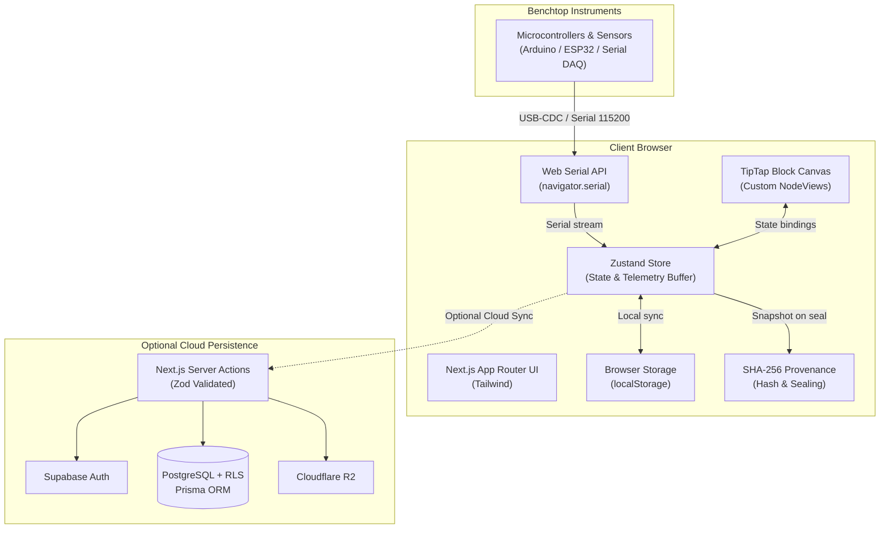

# Inquestra System Architecture

Overview of the subsystems and data flow in Inquestra.

## 1. High-Level Architecture

Inquestra uses a local-first hybrid architecture:



## 2. Core Subsystems

### Block Canvas (`src/components/canvas/EditorCanvas.tsx`)
Built on TipTap (`@tiptap/react`) with custom React NodeViews in `src/components/editor/nodes/`:
- `MoleculeNode`: Renders 2D chemical structures from SMILES or IUPAC queries via PubChem.
- `SequenceNode`: DNA/RNA GC% and melting temperature ($T_m$) calculations.
- `InteractiveChartNode`: Inline charts for CSV data and live serial DAQ streams.
- `ProtocolBlock`: Checklists with step timestamps, deviation notes, and timer bindings.
- `CitationNode`: Literature lookups via Europe PMC and PubMed.
- `MathNode`: Inline and display LaTeX equations rendered with KaTeX.

### Web Serial DAQ (`src/hooks/useWebSerial.ts`)
- Connects directly in Chromium browsers via `navigator.serial` over USB-CDC without external drivers or local Python daemons.
- Parses line-delimited serial packets into a 500-sample live preview buffer and an in-memory session archive in Zustand (`src/store/useNotebookStore.ts`) for full-run CSV/ZIP exports.

### Local-First & Cloud Persistence
- Unauthenticated sessions persist locally in `localStorage` (with `QuotaExceededError` export guardrails) and export sanitized JSON, Markdown, CSV, PDF, and ZIP archives.
- Authenticated cloud persistence runs through Next.js Server Actions (`src/actions/`), Prisma ORM (`prisma/schema.prisma`), Supabase Auth, and PostgreSQL Row-Level Security (`prisma/rls.sql`).

### Record Sealing (`src/lib/provenance.ts`)
- Computes a SHA-256 digest over canvas content, timestamps, and author metadata when sealing a trial, alongside append-only audit log entries.

## 3. Directory Layout

```text
Inquestra/
├── .github/workflows/ci.yml   # GitHub Actions (type-check, lint, build)
├── docs/ARCHITECTURE.md       # Architecture overview
├── prisma/                    # PostgreSQL schema and RLS policies
├── public/                    # Static assets and security.txt
├── src/
│   ├── actions/               # Next.js Server Actions
│   ├── app/                   # App Router pages & API routes
│   ├── components/            # Workspace, editor, hardware, and UI components
│   ├── hooks/                 # React hooks (Web Serial, telemetry sim)
│   ├── lib/                   # Utilities, provenance, sanitization, clients
│   ├── modules/               # Compliance & inventory server actions
│   ├── store/                 # Zustand stores
│   └── types/                 # TypeScript types
├── tests/                     # Playwright specs
├── LICENSE
├── next.config.ts
├── package.json
├── README.md
└── SECURITY.md
```
